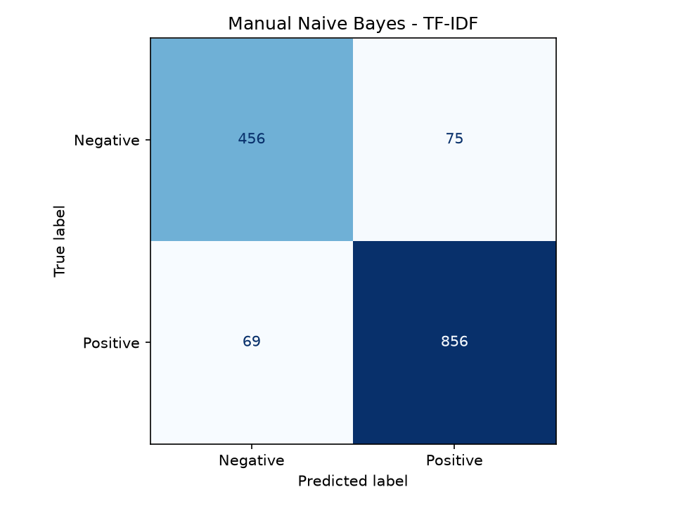

# Naive Bayes code tay + BoW/TF-IDF cho đánh giá sản phẩm

Mô hình phân loại cảm xúc binary (`Negative`, `Positive`) với Multinomial Naive Bayes viết tay.

- Dữ liệu train: `reviews.csv`.
- Chỉ dùng `review_text` và nhãn `sentiment`.
- Cột `star` **không được dùng** làm feature hoặc metric.
- Tokenize bằng `underthesea`, giữ nguyên dấu câu.
- Feature: unigram + bigram liền kề.
- Không bỏ stopword.
- Có smoothing `alpha=0.3`.
- So sánh 2 cách vector hoá:
  - BoW: `sklearn.feature_extraction.text.CountVectorizer`
  - TF-IDF: `sklearn.feature_extraction.text.TfidfVectorizer`
- Chia train/test 80/20 ngẫu nhiên, stratify theo nhãn.
- Đánh giá bằng accuracy, precision, recall, F1-score và confusion matrix.

## Cài đặt

```bash
.venv/Scripts/python.exe -m pip install -r requirements.txt
```

## Huấn luyện

```bash
.venv/Scripts/python.exe -X utf8 scripts/train.py
```

Script sẽ:

1. Đọc `reviews.csv`, bỏ dòng thiếu `review_text`/`sentiment`.
2. Chỉ giữ `Negative`/`Positive`, bỏ duplicate `review_text`.
3. Chia 80/20.
4. Train và đánh giá lần lượt BoW và TF-IDF.
5. Lưu ảnh confusion matrix cho từng phiên bản.
6. Fit lại vectorizer + NB trên toàn bộ dữ liệu và lưu 2 model.

Cấu hình cố định:

```text
alpha=0.3
ngram_range=(1, 2)
tokenizer=underthesea
punctuation=giữ nguyên
```

Output:

```text
models/manual_nb_bow.joblib
models/manual_nb_tfidf.joblib
reports/confusion_matrix_bow.png
reports/confusion_matrix_tfidf.png
```

Mỗi model là một bundle `joblib` (nén `compress=3`) gồm vectorizer, manual NB model và metadata.

## Kết quả đánh giá

Kết quả trên tập test 80/20, `random_state=42`, stratify theo nhãn:

```text
Train rows: 5822 | Test rows: 1456
Vocabulary train: 56829
```

| Input | Accuracy | Macro F1 | Weighted F1 | Neg Precision | Neg Recall | Neg F1 | Pos Precision | Pos Recall | Pos F1 |
|---|---:|---:|---:|---:|---:|---:|---:|---:|---:|
| BoW | 0.8956 | 0.8874 | 0.8956 | 0.8555 | 0.8588 | 0.8571 | 0.9187 | 0.9168 | 0.9177 |
| TF-IDF | 0.9011 | 0.8930 | 0.9010 | 0.8686 | 0.8588 | 0.8636 | 0.9194 | 0.9254 | 0.9224 |

Confusion matrix (hàng = nhãn thật, cột = nhãn dự đoán):

```text
BoW
          Negative  Positive
Negative       456        75
Positive        77       848

TF-IDF
          Negative  Positive
Negative       456        75
Positive        69       856
```




### Nhận xét chi tiết BoW vs TF-IDF

#### 1. Chênh lệch tổng quan

| Chỉ số | BoW | TF-IDF | Chênh lệch |
|---|---:|---:|---:|
| Accuracy | 0.8956 | 0.9011 | +0.0055 |
| Macro F1 | 0.8874 | 0.8930 | +0.0056 |
| Weighted F1 | 0.8956 | 0.9010 | +0.0054 |

- TF-IDF nhỉnh hơn BoW nhưng mức chênh lệch rất nhỏ, khoảng **0.55 điểm phần trăm accuracy**.
- Với 1.456 mẫu test, mức tăng này tương đương khoảng **8 mẫu dự đoán đúng thêm**.
- Chênh lệch nằm trong một lần chia train/test, chưa có cross-validation hoặc kiểm định ý nghĩa thống kê, nên chưa thể kết luận TF-IDF luôn tốt hơn.

#### 2. Phân tích theo lớp

**Lớp Negative**

| Chỉ số | BoW | TF-IDF | Nhận xét |
|---|---:|---:|---|
| Precision | 0.8555 | 0.8686 | TF-IDF tốt hơn |
| Recall | 0.8588 | 0.8588 | Không đổi |
| F1 | 0.8571 | 0.8636 | TF-IDF tốt hơn nhẹ |

- Cả hai model đều dự đoán đúng **456** review Negative.
- Cả hai đều dự đoán sai **75** review Negative thành Positive.
- TF-IDF giảm số review Positive bị đoán nhầm thành Negative từ **77 xuống 69**, nhờ đó precision của Negative tăng.
- Recall Negative không cải thiện vì số Negative bị đoán thành Positive vẫn giữ nguyên là **75**.

**Lớp Positive**

| Chỉ số | BoW | TF-IDF | Nhận xét |
|---|---:|---:|---|
| Precision | 0.9187 | 0.9194 | Gần như không đổi |
| Recall | 0.9168 | 0.9254 | TF-IDF tốt hơn |
| F1 | 0.9177 | 0.9224 | TF-IDF tốt hơn nhẹ |

- TF-IDF dự đoán đúng thêm **8** review Positive.
- Số Positive bị đoán nhầm thành Negative giảm từ **77 xuống 69**.
- Số Negative bị đoán nhầm thành Positive vẫn là **75** ở cả hai model.

Tóm lại, TF-IDF cải thiện chủ yếu ở việc **giảm false negative của lớp Positive** và **tăng precision của lớp Negative**. Điểm yếu chung của cả hai là **75 review Negative vẫn bị dự đoán thành Positive**, tương ứng recall Negative chỉ khoảng `0.8588`.

#### 3. Vì sao có khác biệt

- **BoW** dùng số lần xuất hiện thô. Từ nào xuất hiện nhiều sẽ có trọng số lớn, kể cả các từ phổ biến nhưng ít phân biệt.
- **TF-IDF** giảm trọng số các từ xuất hiện ở nhiều văn bản và tăng trọng số các từ hiếm, có tính phân biệt cao hơn.
- `TfidfVectorizer` mặc định chuẩn hoá L2, nên review dài không bị chi phối quá mạnh bởi số lượng từ.
- Với BoW, manual NB gần với Multinomial NB trên count thuần. Với TF-IDF, manual NB trở thành **weighted NB** trên trọng số TF-IDF, không còn đúng giả định xác suất Multinomial NB ban đầu.
- Vì vậy, score của TF-IDF không nên được diễn giải như xác suất Multinomial NB chuẩn; chỉ nên dùng để so sánh tương đối.

#### 4. Ví dụ định tính

```text
"giao hàng nhanh nhưng hàng quá tệ"
BoW    -> Negative, score -0.8427
TF-IDF -> Positive, score +0.2057
```

- BoW bám vào cụm tiêu cực `hàng quá tệ` mạnh hơn.
- TF-IDF phản ứng mạnh hơn với cụm tích cực `giao hàng nhanh`, dẫn tới dự đoán Positive.
- Ví dụ này cho thấy hai cách vector hoá có thể sai khác nhau trên câu có cả ý tích cực lẫn tiêu cực; không nên dùng một câu để kết luận model nào tốt hơn.

```text
"pin dùng tốt giao hàng nhanh"
BoW    -> Positive, score +1.0000
TF-IDF -> Positive, score +0.9960
```

- Cả hai đều đúng nhãn, nhưng BoW tự tin gần như tuyệt đối; TF-IDF cho score bớt cực đoan hơn.

#### 5. Kết luận

- Nếu ưu tiên **accuracy trên split hiện tại**: chọn TF-IDF.
- Nếu ưu tiên **đơn giản, dễ giải thích và đúng Multinomial NB hơn**: chọn BoW.
- Chênh lệch hiện tại chưa đủ lớn để nói TF-IDF vượt trội rõ rệt.
- Để kết luận chắc hơn nên:
  - chạy cross-validation,
  - thử nhiều `alpha` và `ngram_range`,
  - phân tích các câu dự đoán sai,
  - bổ sung xử lý phủ định và cụm đối lập,
  - hiệu chỉnh ngưỡng dự đoán nếu cần ưu tiên precision hoặc recall.

## Dự đoán

BoW:

```bash
.venv/Scripts/python.exe -X utf8 scripts/predict_bow.py "Pin dùng rất tốt, giao hàng nhanh"
```

TF-IDF:

```bash
.venv/Scripts/python.exe -X utf8 scripts/predict_tfidf.py "Pin dùng rất tốt, giao hàng nhanh"
```

Kết quả gồm nhãn dự đoán, xác suất `Negative`/`Positive` và `score` trong `[-1, 1]`:

```text
score = P(Positive) - P(Negative)
```

TF-IDF + manual NB là weighted NB trên trọng số TF-IDF, không còn đúng Multinomial NB trên count thuần.

## Đánh nhãn tự động cho `reviews.jsonl`

Dữ liệu nhãn yếu được tạo theo rule star + underthesea:

- star 1–2 → `Negative`
- star 4–5 → `Positive`
- star 3 hoặc star lẫn cực → `underthesea`
  - `positive` → `Positive`
  - `negative` → `Negative`
  - `neutral` → `Negative` (ép)
  - `None`/lỗi/label lạ → `SKIP`
- text rác/emoji-only → `SKIP`

Đây là **weak labels**, không phải nhãn người, nên metrics chỉ có ý nghĩa tham khảo.

## Cấu trúc

```text
src/
  manual_nb.py       # Multinomial NB code tay
  vectorizers.py     # CountVectorizer và TfidfVectorizer
  config.py          # đường dẫn labeling
  labeling.py        # rule gán nhãn yếu
scripts/
  train.py           # train, đánh giá, lưu 2 model
  predict_bow.py     # dự đoán bằng BoW
  predict_tfidf.py   # dự đoán bằng TF-IDF
```
